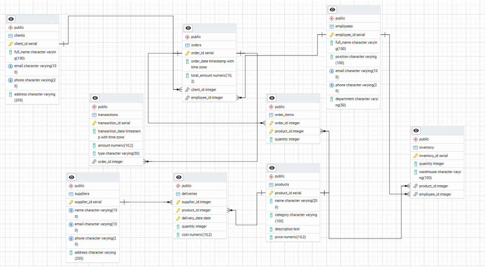
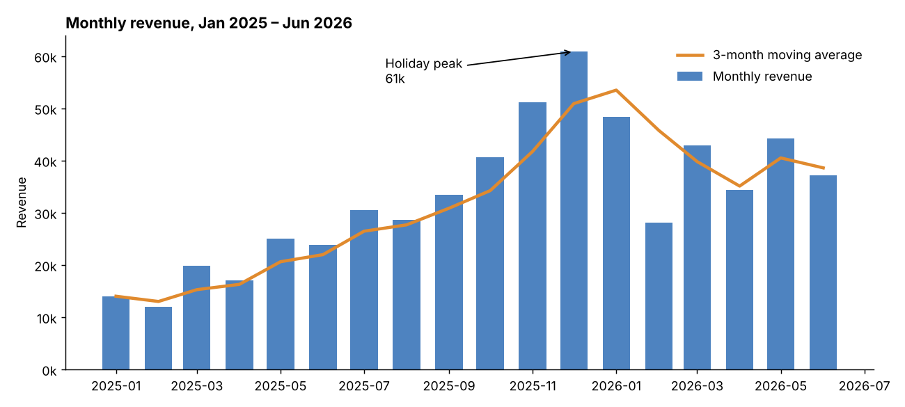
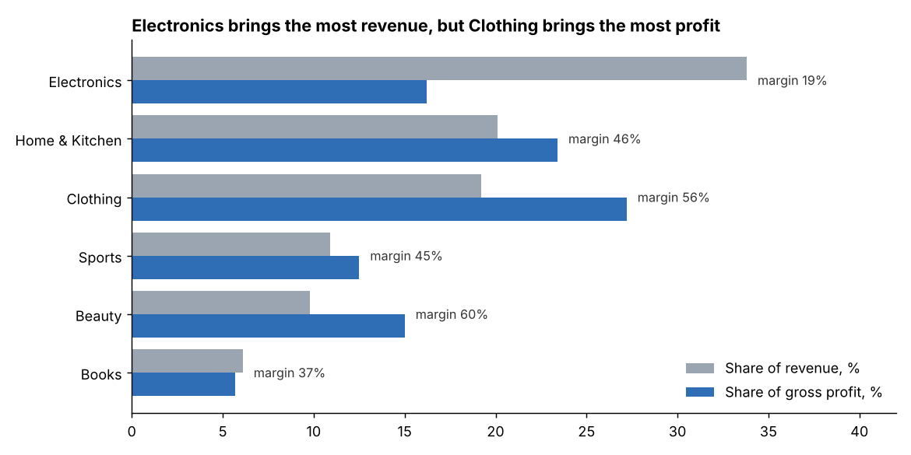
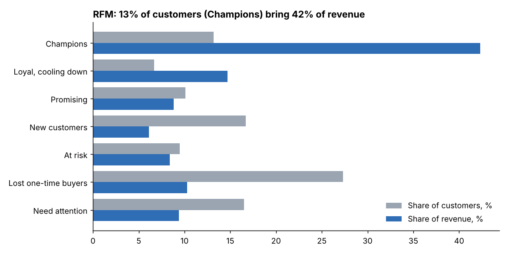
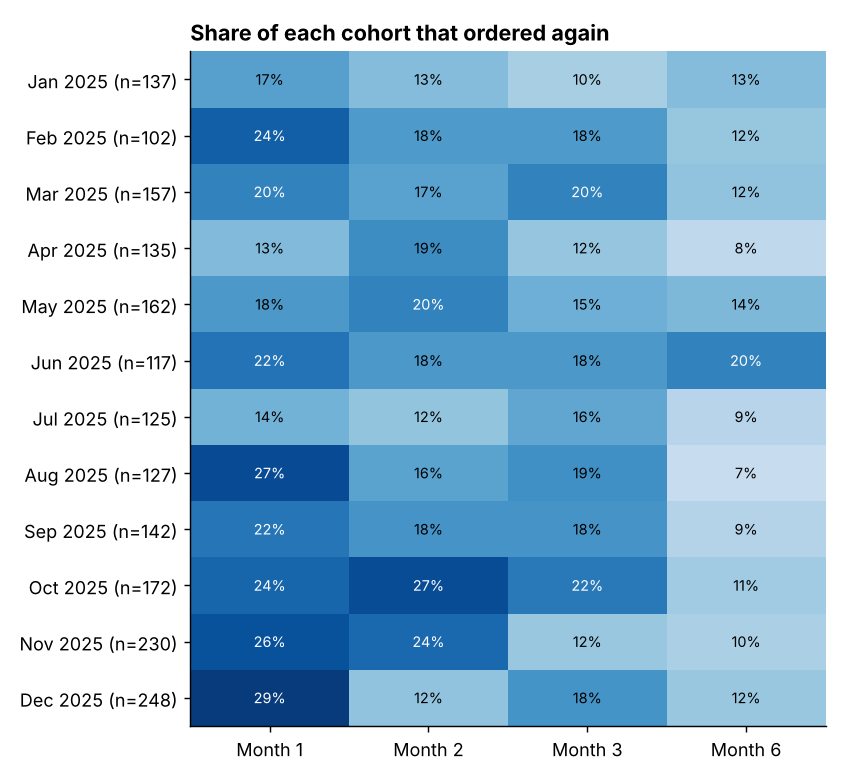

# Sales & Inventory Analytics in PostgreSQL

An end-to-end SQL project for a fictional retail company, **ABC Corporation**. It covers the whole path: designing a normalized database, protecting data quality with constraints and triggers, and using SQL to answer business questions about revenue, profit, customers and stock.

**Stack:** PostgreSQL 16 · SQL (CTEs, window functions) · PL/pgSQL · Python (data generation, charts) · pgAdmin · draw.io

> **About the data:** the dataset is **synthetic**. I generated it with [`data/generate_data.py`](data/generate_data.py) because real company data was not available. The generator deliberately builds in realistic behaviour, such as customer segments with different loyalty, holiday seasonality, different margins and refund rates by category, and products that stopped being restocked. The goal of the project is to show the **analysis method**. The numbers are not real-world findings.

---

## 1. Database design



- **9 tables:** clients, employees, suppliers, products, orders, order_items, transactions, deliveries, inventory
- Conceptual ER model → logical model → physical schema. The M:N relationship between orders and products is resolved through `order_items`.
- Normalized to **3NF / BCNF**: no partial or transitive dependencies
- Integrity: primary and foreign keys with `ON DELETE RESTRICT / CASCADE` rules, `UNIQUE`, `NOT NULL`, and `CHECK` constraints (prices ≥ 0, quantities > 0, transaction types, and **regex validation of emails**)

Code: [`sql/01_schema.sql`](sql/01_schema.sql)

## 2. Business logic in PL/pgSQL

| Object | What it does |
|---|---|
| `trg_check_delivery_date` | rejects deliveries dated in the future |
| `trg_update_inventory` | each delivery automatically increases stock |
| `trg_decrease_inventory` | an order line is accepted only if stock is sufficient, and the stock is then written off |
| `calculate_order_total(order_id)` | order value = Σ quantity × price |
| `get_top_selling_product()` | best-selling product by units |
| `calculate_profit(from, to)` | payments − refunds − purchase costs for a period |

When the data was loaded, the triggers processed all **11,353 order lines**, and stock never went negative.

Code: [`sql/02_triggers_functions.sql`](sql/02_triggers_functions.sql)

## 3. Data

| Table | Rows |
|---|---|
| clients | 2,600 |
| orders | 6,827 |
| order_items | 11,353 |
| transactions | 7,381 |
| deliveries | 820 |
| products / employees / suppliers | 60 / 12 / 8 |

Period: **January 2025 – June 2026**.

## 4. Analysis

12 queries in [`sql/03_analytics.sql`](sql/03_analytics.sql). All outputs are in [`results/RESULTS.md`](results/RESULTS.md).

| # | Business question | SQL techniques |
|---|---|---|
| Q1 | Overall KPIs: revenue, AOV, refund rate | CTE, CROSS JOIN |
| Q2 | Monthly revenue, MoM growth, moving average | `DATE_TRUNC`, `LAG`, `AVG/SUM OVER` |
| Q3 | Category revenue and share | `SUM() OVER ()` |
| Q4 | Gross margin by category | CTE, unit cost from deliveries |
| Q5 | Top-3 products in each category | `RANK() OVER (PARTITION BY)` |
| Q6 | Refund rate by category | `FILTER`, `LEFT JOIN` |
| Q7 | Revenue from repeat customers | `CASE` buckets, window shares |
| Q8 | Monthly cohort retention | cohort CTE, `FILTER` pivot |
| Q9 | RFM customer segmentation | `NTILE`, `CASE` |
| Q10 | Sales team performance | `RANK`, department share |
| Q11 | Days of stock cover and reorder alerts | 3 CTEs, `NULLIF` |
| Q12 | Data-quality checks | `NOT EXISTS`, `UNION ALL`, stored function |

### Key insights

**1. Revenue grew almost 3× in 18 months and has a strong holiday peak.** Monthly revenue grew from 14k (Jan 2025) to 34–44k a month in spring 2026. December 2025 was the peak at 61k. February 2026 fell 42% month over month, so the post-holiday dip should be planned for.



**2. Revenue ≠ profit.** Electronics brings **34% of revenue but only 16% of gross profit** (19% margin). Clothing has a 56% margin and is the biggest profit contributor (27%). Beauty has the highest margin (60%).
→ *Promote high-margin categories. Review Electronics pricing and supplier terms.*



**3. Clothing has the highest refund rate.** 14.4% of orders with clothing had a refund, against 6–10% for other categories. That cuts into its high margin.
→ *Look into the reasons, such as sizing. Better size guides could cut returns.*

**4. A small group of loyal customers drives the business.** 54% of customers ordered only once. Customers with 6+ orders are **11% of the base but bring 41% of revenue**. In the RFM segmentation, Champions (13% of customers) bring 42% of revenue.
→ *Use a loyalty programme for Champions. Run a win-back campaign for the 174 "Loyal, cooling down" customers, who average 6 orders but have not bought in ~8 months.*



**5. Retention:** 13–29% of each monthly cohort orders again in the following month. Holiday cohorts (Nov–Dec 2025) are the largest, and December's has the best month-1 return rate (29%).



**6. Stock alerts.** Based on the last 90 days of sales, *Denim Jacket* and *Sci-Fi Trilogy* have **3–5 days of stock left** (last delivery in March), and *Cycling Gloves* has 17 days.
→ *Reorder now.*

**7. Sales team:** average order value is almost the same across managers (82–92). The differences come from the **number of orders handled**, not from order size.

**8. Data quality:** every order total matches Σ items × price, every order has a payment equal to its total, and there are no orders without items and no negative stock.

## Fixes I made to my original university lab code

- `calculate_profit` now subtracts refunds (the first version only counted payments).
- The date filter in `calculate_profit` casts timestamps to dates, so the last day of the period is included.
- Added indexes on foreign keys and date columns used in joins and filters.

## How to run

```bash
createdb abc_corp
psql -d abc_corp -f sql/01_schema.sql
psql -d abc_corp -f sql/02_triggers_functions.sql
psql -d abc_corp -f sql/00_load_data.sql          # loads data/csv/*.csv
python run_analysis.py "psql -d abc_corp"         # runs all queries -> results/
python make_charts.py                             # charts -> images/
```

To regenerate the data: `python data/generate_data.py`.

---
Based on my coursework in *Introduction to Databases and Information Systems* at Igor Sikorsky Kyiv Polytechnic Institute (2025), then extended with data generation and analysis.
